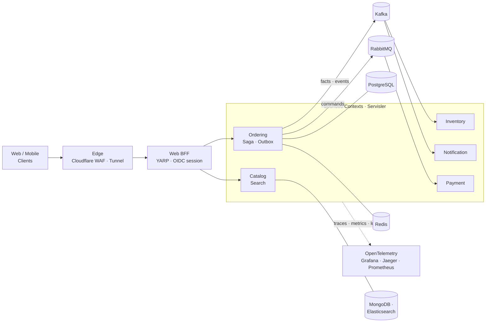
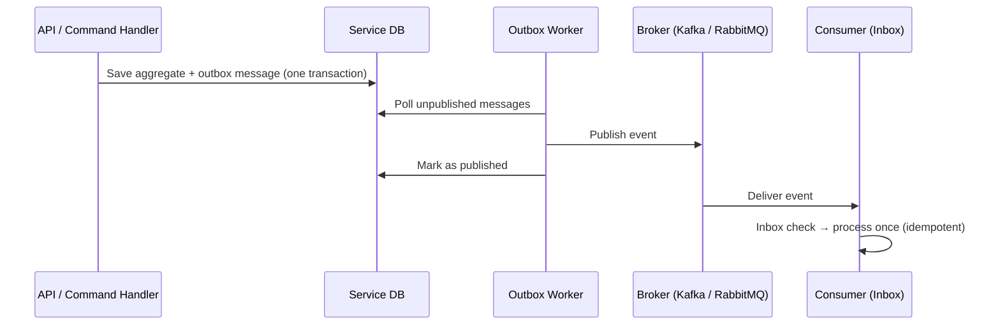
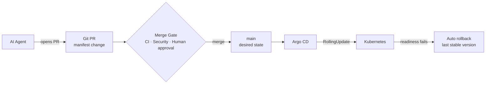

<h1 align="center">Alihan Berat Çelik</h1>
<h3 align="center">Backend & Cloud-Native Developer · Software Architecture · Distributed Systems</h3>

  
  
  

  <a href="#-english">🇬🇧 English</a> · <a href="#-türkçe">🇹🇷 Türkçe</a>

---

## 🇬🇧 English

I design and build **backend systems end to end** — from the domain model and service boundaries to messaging, data, deployment and observability. I think in terms of **systems**: how the parts talk, how they fail, how they recover and how you see what is happening inside them.

- 🧱 **Architecture:** Clean Architecture, DDD, CQRS, Vertical Slice, Modular Monolith and Microservices — chosen per problem, not by habit.
- 🔁 **Distributed systems:** event-driven design, Saga orchestration, Outbox/Inbox, idempotent consumers, Kafka, RabbitMQ, Redis Streams, Azure Service Bus.
- ☁️ **Platform:** Docker, Kubernetes, GitOps with Argo CD, Azure Functions, CI/CD with GitHub Actions.
- 🔭 **Observability:** OpenTelemetry, Jaeger, Prometheus, Grafana, ELK — every request traceable across services.
- 🤖 **AI in production:** agentic workflows with human-in-the-loop gates, local LLMs (Ollama), Semantic Kernel, LangGraph.
- 🚀 I build real products at **[Kozmoz İnovasyon](https://www.kozmozinovasyon.com)** — from system design to the app in the store.

## 🇹🇷 Türkçe

**Backend sistemlerini uçtan uca** tasarlayıp geliştiriyorum — domain modeli ve servis sınırlarından mesajlaşmaya, veriye, dağıtıma ve gözlemlenebilirliğe kadar. Yazılıma **sistem mühendisliği** gözüyle bakıyorum: parçalar nasıl konuşur, nasıl hata verir, nasıl toparlanır ve içeride ne olduğunu nasıl görürsün.

- 🧱 **Mimari:** Clean Architecture, DDD, CQRS, Vertical Slice, Modular Monolith ve Mikroservisler — alışkanlıkla değil, probleme göre seçilir.
- 🔁 **Dağıtık sistemler:** event-driven tasarım, Saga orkestrasyonu, Outbox/Inbox, idempotent tüketiciler, Kafka, RabbitMQ, Redis Streams, Azure Service Bus.
- ☁️ **Platform:** Docker, Kubernetes, Argo CD ile GitOps, Azure Functions, GitHub Actions ile CI/CD.
- 🔭 **Gözlemlenebilirlik:** OpenTelemetry, Jaeger, Prometheus, Grafana, ELK — her istek servisler arasında izlenebilir.
- 🤖 **Üretimde yapay zekâ:** insan onay kapılı ajan iş akışları, yerel LLM'ler (Ollama), Semantic Kernel, LangGraph.
- 🚀 **[Kozmoz İnovasyon](https://www.kozmozinovasyon.com)** çatısı altında gerçek ürünler geliştiriyorum — sistem tasarımından mağazadaki uygulamaya kadar.

---

## 🏗️ How I Design Systems · Sistemleri Nasıl Tasarlıyorum

**EN:** A typical platform I build: an edge layer and a BFF in front, services that own their data, events for facts and queues for commands, and one trace for every request.
**TR:** Kurduğum tipik bir platform: önde edge katmanı ve BFF, kendi verisine sahip servisler, olaylar için event, komutlar için kuyruk ve her istek için tek bir trace.

**EN:** Reliable messaging without distributed transactions — the Outbox pattern I use across my services:
**TR:** Dağıtık transaction olmadan güvenilir mesajlaşma — servislerimde kullandığım Outbox kalıbı:

**EN:** Agentic GitOps — AI agents write to Git, never to the cluster; a human approves and Argo CD applies.
**TR:** Agentic GitOps — yapay zekâ ajanları cluster'a değil Git'e yazar; insan onaylar, Argo CD uygular.

---

## 🚀 Products I've Built · Geliştirdiğim Ürünler

| Product · Ürün | EN | TR | Architecture · Stack |
|---|---|---|---|
| [**Sıram**](https://www.kozmozinovasyon.com/products/siram) | Appointment, reminder and calendar app for barbers, salons and small businesses. | Berber, kuaför ve küçük işletmeler için randevu, hatırlatma ve takvim uygulaması. | Expo · React Native · TypeScript |
| [**Planyol**](https://www.kozmozinovasyon.com/products/planyol) | Multi-tenant project & field management for construction, architecture and engineering firms — tasks, site, finance, team. Offline-first mobile with sync. | İnşaat, mimarlık ve mühendislik firmaları için çok kiracılı proje & saha yönetimi — görev, saha, finans, ekip. Senkronizasyonlu çevrimdışı mobil. | NestJS · Prisma · PostgreSQL · Socket.IO · FCM · Expo · Turborepo monorepo |
| **AI-Do** | AI-assisted productivity app: tasks, Pomodoro, analytics and smart suggestions. Backend designed for 10k+ RPS. | Yapay zekâ destekli verimlilik uygulaması: görevler, Pomodoro, analitik ve akıllı öneriler. Backend 10k+ RPS için tasarlandı. | .NET 10 Modular Monolith · DDD · CQRS · Outbox · OpenTelemetry · React Native |
| **Shop Microservices** *(in progress · geliştiriliyor)* | DDD e-commerce platform of six bounded contexts on Kubernetes: Kafka + RabbitMQ, polyglot persistence, GitOps with Argo CD, Cloudflare edge. | Kubernetes üzerinde altı bounded context'li DDD e-ticaret platformu: Kafka + RabbitMQ, çoklu veri deposu, Argo CD ile GitOps, Cloudflare edge. | .NET · Kafka · RabbitMQ · PostgreSQL · MongoDB · Argo CD · KEDA · Vault |

---

## 📐 Architecture Projects · Mimari Projeler

| Project · Proje | EN | TR |
|---|---|---|
| [**Agentic GitOps & Argo CD**](https://github.com/Kozmoz-Inovasyon/agentic-gitops-argocd) | Reference architecture for safely bringing AI agents into the delivery pipeline with human-in-the-loop gates. | Yapay zekâ ajanlarını insan onay kapılarıyla teslim hattına güvenle dahil eden referans mimari. |
| [**Multi-Agent Orchestration**](https://github.com/Kozmoz-Inovasyon/evrak-orkestrasyonu) | Document pipeline orchestrated as a graph of agents with an approval gate and node-level retries. | Onay kapısı ve düğüm bazlı yeniden denemeyle graf olarak orkestre edilen evrak hattı. |
| [**ResultFlow**](https://github.com/alihanbb/ResultFlow) | Railway-Oriented Programming Result library for .NET 8 — chainable, allocation-aware, RFC 7807. | .NET 8 için Railway-Oriented Programming Result kütüphanesi — zincirlenebilir, düşük bellek tahsisli, RFC 7807. |
| [**Modular Monolith – Event Driven**](https://github.com/alihanbb/Modular_Monolith_EventDriven_MemoryStream) | Isolated modules with a custom in-memory event bus, Outbox and Inbox. | Özel in-memory event bus, Outbox ve Inbox ile izole modüller. |
| [**Aspire GenAI Microservices**](https://github.com/alihanbb/aspire-genai-microservice) | .NET Aspire microservices with Saga, Outbox, CQRS and Ollama-powered semantic search. | Saga, Outbox, CQRS ve Ollama destekli semantik arama ile .NET Aspire mikroservisleri. |
| [**.NET 9 OpenTelemetry Stack**](https://github.com/alihanbb/dotnet9-opentelemetry-stack) | Production-ready observability pipeline: OTel, ELK, Prometheus, Grafana, Jaeger. | Üretime hazır gözlemlenebilirlik hattı: OTel, ELK, Prometheus, Grafana, Jaeger. |
| [**Microservices with Redis Streams**](https://github.com/alihanbb/Microservice_RedisStream) | Event-driven services over Redis Streams with tracing, health checks and rate limiting. | Tracing, health check ve rate limiting ile Redis Streams üzerinden event-driven servisler. |
| [**Vertical Slice – End to End**](https://github.com/alihanbb/Vertical-Slice-Architechture---End-to-End) | Project management API with Vertical Slice Architecture and Domain Events. | Vertical Slice Architecture ve Domain Event'lerle proje yönetimi API'si. |
| [**Azure Serverless**](https://github.com/alihanbb/Azure_Serverless) | Event-driven order processing on Azure Functions with MassTransit, retries and circuit breaker. | MassTransit, retry ve circuit breaker ile Azure Functions üzerinde event-driven sipariş işleme. |
| [**GraphQL + CQRS + Clean Architecture**](https://github.com/alihanbb/dotnet-graphql-cqrs-clean-architechture) | GraphQL API with RabbitMQ events and Elasticsearch. | RabbitMQ olayları ve Elasticsearch ile GraphQL API. |
| [**Clean Architecture Template**](https://github.com/alihanbb/CleanArchitecture-Template) | .NET 9 boilerplate: JWT, caching, event bus, Docker Compose, tests. | .NET 9 şablonu: JWT, önbellek, event bus, Docker Compose, testler. |

---

## 🛠️ Tech Stack · Teknolojiler

**Languages · Diller**

**Backend**

**Messaging & Data · Mesajlaşma ve Veri**

**Cloud, DevOps & Observability · Bulut, DevOps ve Gözlemlenebilirlik**

**AI · Yapay Zekâ**

---

## 🎯 Goals · Hedefler

| EN | TR |
|---|---|
| Grow into **software & platform architecture**: designing systems that scale, fail safely and stay observable. | **Yazılım ve platform mimarlığında** derinleşmek: ölçeklenen, güvenli şekilde hata veren ve gözlemlenebilir kalan sistemler tasarlamak. |
| Run production workloads on **Kubernetes with GitOps** end to end. | **Kubernetes ve GitOps** ile üretim iş yüklerini uçtan uca yönetmek. |
| Build **AI-native backends** where agents work behind clear, human-approved gates. | Ajanların net, insan onaylı kapılar arkasında çalıştığı **AI-native backend'ler** kurmak. |
| Share what I learn through open source and writing at [kozmozinovasyon.com](https://www.kozmozinovasyon.com/insights). | Öğrendiklerimi açık kaynak ve [kozmozinovasyon.com](https://www.kozmozinovasyon.com/insights) yazılarıyla paylaşmak. |

---

## 📊 GitHub Stats

  

---

## 📫 Contact · İletişim

  
  
  

<i>"Make it work, make it right, make it observable."</i>

